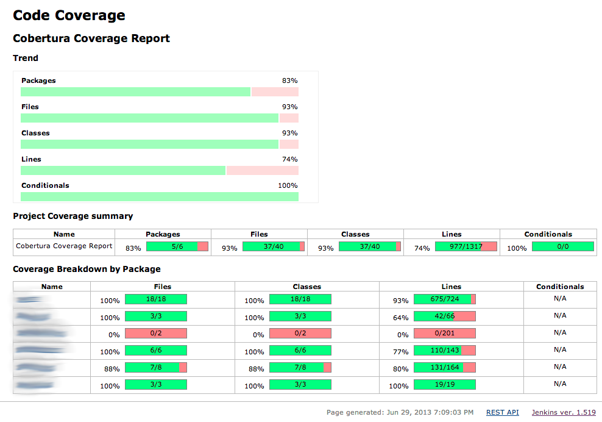

## Delivery of {GroupName}

* John Doe (john.doe@something.com)
* Jane Doe (jane.doe@something.com)

### MVP

| Feature                                                                                | Done | Comments |
|----------------------------------------------------------------------------------------|:----:|----------|
| Authentication (Basic Register/login, etc.)                                            |  ❌   |          |
| View list of videos (using videos generated by `videoGrabber` tool)                    |  ❌   |          |
| Persistence using a database (not in memory or h2)                                     |  ❌   |          |
| Upload videos for authenticated users                                                  |  ❌   |          |
| Analytics for authenticated users                                                      |  ❌   |          |
| Play a video and show information about the video (title, description, comments, etc.) |  ❌   |          |
| Presentations of the progress on sprint reviews/demo                                   |  ❌   |          |
| Search engine to search videos by title, description, etc.                             |  ❌   |          |
| Comments (replies, likes, etc.)                                                        |  ❌   |          |
| User profile (avatar, description, etc.)                                               |  ❌   |          |
| Video metadata editor (tags, description, category, etc.)                              |  ❌   |          |
| E2E tests (Cypress, Selenium, etc.)\*                                                  |  ❌   |          |
| Use of containerization (docker-compose) to deliver the application.\*                 |  ❌   |          |
| Validation of the changes via a CI pipeline (Github Actions)                           |  ❌   |          |
| **EVERYTHING** has to be well tested and have more than 50% of coverage                |  ❌   |          |

#### Env variables configuration
* ENV_PROTUBE_DB_USER
* ENV_PROTUBE_DB_PASS
* ENV_PROTUBE_STORE_DIR

* ENV_PROTUBE_GOOGLE_CLIENT_ID (Optional, only if you use OAUTH from google)
* ENV_PROTUBE_GOOGLE_CLIENT_SECRET (Optional, only if you use OAUTH from google)

In case we need some other different ENV Variables to run the project, please document it here.

#### How to run the project
```shell
docker-compose 
```

### Improvements


**Product:**

| Feature                                           | Done | Comments |
|---------------------------------------------------|:----:|----------|
| Authentication with OAuth or other similar system |  ❌   |          |
| Rating videos                                     |  ❌   |          |
| Mobile/Responsiveness                             |  ❌   |          |
| Favorite videos                                   |  ❌   |          |
| Subscriptions to other users                      |  ❌   |          |
| Dark mode                                         |  ❌   |          |
| Internationalization (i18n)                       |  ❌   |          |
| Accessibility (a11y)                              |  ❌   |          |
| Add your improvement here                         |  ❌   |          |


**Engineering:**

| Feature                                                          | Done | Comments |
|------------------------------------------------------------------|:----:|----------|
| Code quality toolings (SonarQube, ESLint, etc.)                  |  ❌   |          |
| More than 90% of test coverage                                   |  ❌   |          |
| Use a static server to save resources (Cloudinary, AWS S3, etc.) |  ❌   |          |
| Use of a caching system (Redis, Memcached, etc.)                 |  ❌   |          |
| Use of design patterns                                           |  ❌   |          |
| Documentation (Swagger, JSDocs etc.)                             |  ❌   |          |
| Use of microservices architecture                                |  ❌   |          |
| Hexagonal architecture                                           |  ❌   |          |
| Kubernetes deployment                                            |  ❌   |          |
| Deploy app on a hyperscaler (AWS, Azure, GCP, etc.)              |  ❌   |          |
| Add your improvement here                                        |  ❌   |          |

####  More than 90% of test coverage
We introduced a high coverage in the project...


**Agile:**

| Feature                                                                | Done | Comments | Links |
|------------------------------------------------------------------------|:----:|----------|-----|
| Keeping all ceremonies on every sprint                                 |  ❌   |          |    |
| Use of Gitflow or other similar branching model                        |  ❌   |          |    |
| Use of Jira, Trello or other similar tool to manage the project        |  ❌   |          |    |
| Use of Confluence or other similar tool to document the project        |  ❌   |          |    |
| Use of Slack or other similar tool to communicate with the team        |  ❌   |          |    |
| Use of Miro or other similar tool to create diagrams, flowcharts, etc. |  ❌   |          |    |
| Use of Figma or other similar tool to create mockups, wireframes, etc. |  ❌   |          |    |
| Creating a good backlog with user stories, tasks, etc.                 |  ❌   |          |    |
| Add your improvement here                                              |  ❌   |          |    |